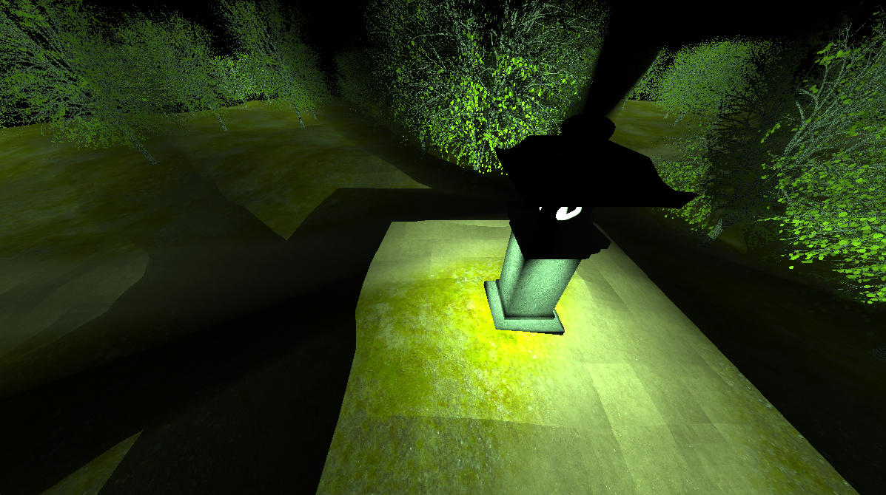

# JAM Engine

<p align="center">
  
</p>

<p align="center">
  <b>A C++20 / OpenGL 4.3 game engine written from scratch by three students.</b><br>
  Entity system, forward and deferred lighting, shadow mapping, volumetric lighting, 3D audio and its own math library.
</p>

<p align="center">
  <a href="https://alangutier24.github.io/">Documentation site</a> ·
  <a href="https://www.youtube.com/watch?v=P3VPoWwbqnI">Demo video</a>
</p>

---

## About

JAM Engine was built over one academic year for the **Graphics Engines** course at ESAT (Valencia, Spain) and finished in 2024. The name comes from the team: **J**avier Guinot, **A**lan Gutierrez and **M**arcos Jimenez.

This repository hosts the engine's **documentation site**: one page per module with its API, configuration and usage examples. The engine's source code is not public.

| | |
|---|---|
| Language | C++20 |
| Graphics API | OpenGL 4.3 |
| Windowing | GLFW |
| Audio | OpenAL |
| Math | Own library (vectors, matrices, utilities) |
| Platforms | Windows and Linux, x64 |

## Modules

Each module links to its page on the documentation site.

| Module | What it covers | Authors |
|---|---|---|
| [Engine](https://alangutier24.github.io/element_pages/engine.html) | Init / update / render loop, configuration, input, resource upload | Javier Guinot, Alan Gutierrez, Marcos Jimenez |
| [Lights](https://alangutier24.github.io/element_pages/lights.html) | Point, spot and directional lights | Alan Gutierrez |
| [Shadows](https://alangutier24.github.io/element_pages/shadows.html) | Shadow mapping for every light type | Alan Gutierrez, Javier Guinot |
| [Volumetric lighting](https://alangutier24.github.io/element_pages/v_lighting.html) | Per-light volumetric scattering in GLSL | Alan Gutierrez, Javier Guinot |
| [Sound](https://alangutier24.github.io/element_pages/sound.html) | Positional audio sources | Alan Gutierrez, Javier Guinot |
| [OBJ meshes](https://alangutier24.github.io/element_pages/meshes.html) | OBJ and MTL loading | Marcos Jimenez, Alan Gutierrez |
| [ECS](https://alangutier24.github.io/element_pages/ecs.html) | Entity manager and components | Javier Guinot |
| [Task manager](https://alangutier24.github.io/element_pages/threads.html) | Running work on separate threads | Javier Guinot |
| Shader | Shader programs | Javier Guinot, Marcos Jimenez |
| [Textures](https://alangutier24.github.io/element_pages/textures.html) | Texture loading, wrap and filter modes | Javier Guinot |
| [Window](https://alangutier24.github.io/element_pages/window.html) | Window creation and configuration | Javier Guinot |
| [Math library](https://alangutier24.github.io/element_pages/math_lib.html) | Vectors, matrices and helpers | Marcos Jimenez, Javier Guinot |
| [Transform](https://alangutier24.github.io/element_pages/transform.html) | Position, rotation and scale | Marcos Jimenez |
| [Fly camera](https://alangutier24.github.io/element_pages/fly_camera.html) | Free-fly camera | Marcos Jimenez |
| [Timer](https://alangutier24.github.io/element_pages/timer.html) | Timing utilities | Javier Guinot |
| [Error logger](https://alangutier24.github.io/element_pages/error_logger.html) | Error reporting | Javier Guinot |

## My work on the engine

I'm Alan Gutierrez. These are the parts I wrote or co-wrote.

**Lights** (sole author)
- Point, spot and directional lights, added through `AddLight(...)` and addressed by id.
- Lights are described by parameters such as brightness, specular strength and shininess, constant / linear / quadratic attenuation and, for spot lights, inner and outer cut-off.
- Works in both render paths the camera can select: **forward** and **deferred**. In the deferred path the lighting shader reads world position and normal from G-buffer textures.
- Light data reaches the shaders through a buffer, so every shader sees the same light arrays (`spot_light_[i]`, `point_light_[i]`, …) and accumulates them additively.

**Shadows** (with Javier Guinot)
- Shadow mapping from each light's depth buffer, for all three light types.
- Shadow maps are stored as one `sampler2DArray` per light type and bound to every shader automatically.
- The user marks casters between `BeginRenderShadow(light_id, light_type)` and `EndRenderShadow()`; shaders apply the result with `GetShadowFactor(...)`.
- Shadow map resolution is chosen in the engine configuration.

**Volumetric lighting** (with Javier Guinot)
- Enabled per light with `use_volumetric_ = true`.
- Evaluated in GLSL with `GetVolumetricLight(light, shadow_map, layer, pixel_pos, attenuation, max_distance, step_offset)`, with one overload per light type, so the light's own shadow map decides where the beam is occluded.

**Sound** (with Javier Guinot)
- `SoundCore` singleton on top of OpenAL.
- Sources with gain, pitch, 3D position, velocity and looping; play, pause, stop and rewind.

**OBJ meshes** (with Marcos Jimenez)
- Loading of OBJ files with their MTL materials.

## Minimal program

Opening a window takes a configuration struct and three callbacks:

```cpp
static f32 win_x = 16 * 75;
static f32 win_y = 9 * 75;

void UserInit(s32 argc, byte *argv[], void *) {}
void UserUpdate(void *) {}
void UserClean(void *) {}

s32 main(s32 argc, byte *argv[])
{
  JAM_Engine::Config config = {
    argc, argv,
    static_cast<s32>(win_x),
    static_cast<s32>(win_y),
    false, true, true,
    ShadowsManager::Resolution::Low,
    ShadowsManager::Resolution::Low,
    ShadowsManager::Resolution::Low };

  JAM_Engine::Init(UserInit, config);
  JAM_Engine::Update(UserUpdate);
  JAM_Engine::Clean(UserClean);

  return 0;
}
```

Drawing goes inside `UserUpdate`, between `JAM_Engine::BeginRender(&camera)` and `JAM_Engine::EndRender()`. The [engine page](https://alangutier24.github.io/element_pages/engine.html) walks through a full example.

## Team

- **Javier Guinot**
- **Alan Gutierrez**: [portfolio](https://alangutier24.github.io/alangutierrezramirez/) · [GitHub](https://github.com/alangutier24) · [LinkedIn](https://www.linkedin.com/in/alan-gutierrez-ramirez-81379921b)
- **Marcos Jimenez**

## Credits

The site is built on a Bootstrap template. Third-party libraries and image sources are listed in [CREDITS.txt](CREDITS.txt).
